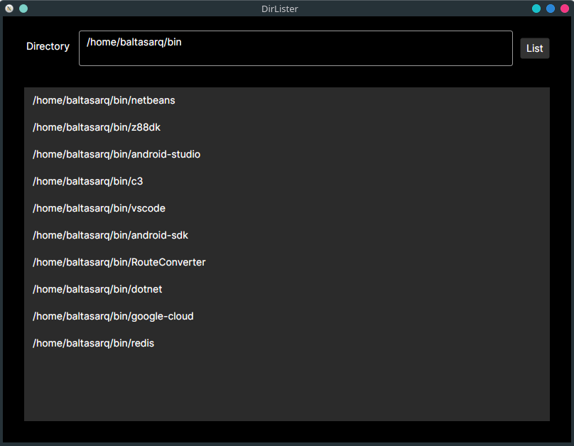

# File explorer

A simple file explorer created with C# and Avalonia.

Possible expansions:

- List only the name of files and directories, instead the whole path.
- Add a view panel to the right, in order to show the contents of text files.
- Add a view panel to the right, in order to show the contents of image files.
- Add a tree panel to the left, in order to show the hierarchy of directories.
